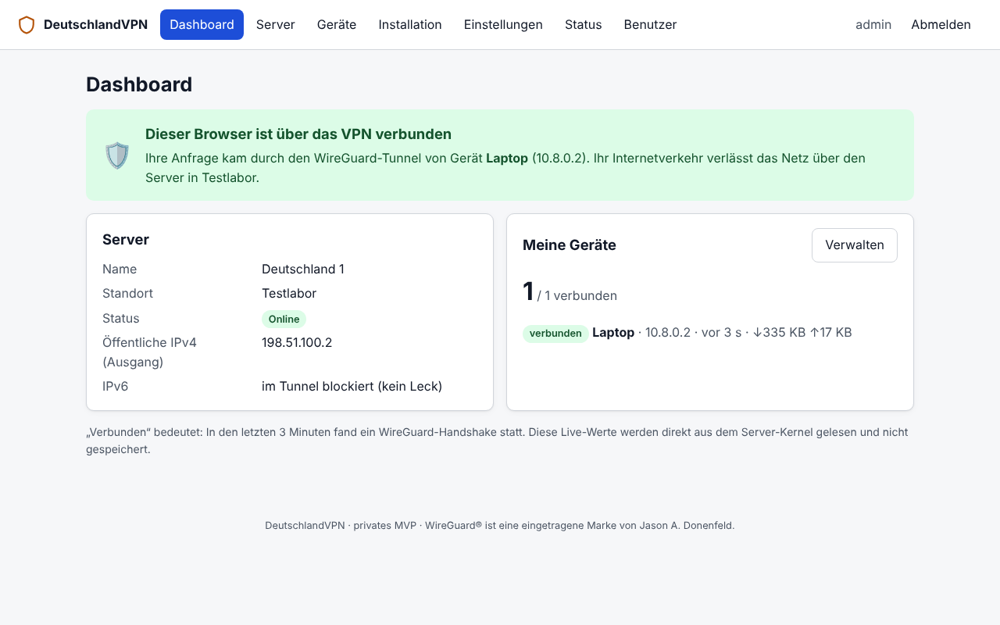
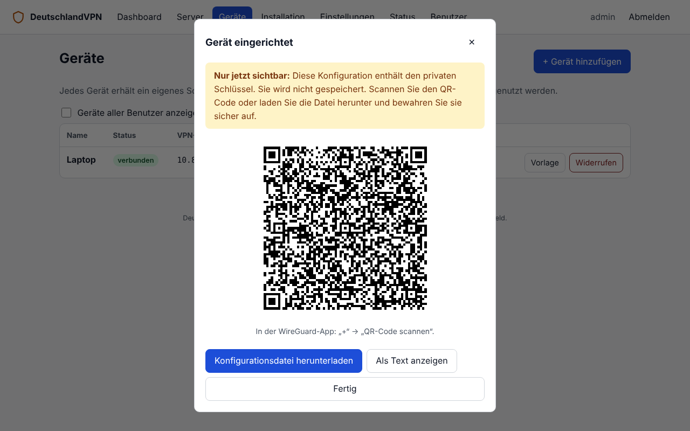

# DeutschlandVPN

Ein **echter, selbst betriebener WireGuard-VPN-Dienst** mit Serverstandort in Deutschland, einer deutschsprachigen Weboberfläche zur Geräteverwaltung und Fokus auf Sicherheit, Datensparsamkeit und niedrige Kosten (ab ca. 4 € pro Monat für einen VPS, privat auch praktisch kostenlos zu Hause, siehe [docs/kostenlos.md](docs/kostenlos.md)).

> Status: **privates MVP**. Für den Eigenbetrieb und eingeladene Personen gedacht. Für einen öffentlichen Betrieb siehe [docs/produktivbetrieb.md](docs/produktivbetrieb.md).

| Dashboard (über VPN verbunden) | Gerät anlegen: Schlüssel entsteht im Browser |
|---|---|
|  |  |

Die Screenshots stammen aus der automatisierten Testumgebung. Der Browser war dabei über einen echten WireGuard-Tunnel verbunden, Schlüssel und QR-Code sind Wegwerf-Testdaten.

## Was ist das – und was nicht?

- **Ist:** ein VPN auf Basis von WireGuard. Ihre Geräte verbinden sich mit der **offiziellen WireGuard-App** zu Ihrem Server in Deutschland. Der gesamte Verkehr (IPv4, DNS und IPv6) läuft durch den Tunnel und verlässt das Netz mit der deutschen IP des Servers.
- **Ist nicht:** eine Proxy-Webseite. Die Weboberfläche verwaltet nur Konten und Gerätekonfigurationen. Sie kann (und soll) keinen Verkehr umleiten.
- **Ist nicht:** ein Anonymisierungsdienst. Siehe [docs/sicherheit.md](docs/sicherheit.md), Abschnitt „Grenzen“.

## Funktionen und Stand

Legende: ✅ implementiert **und** automatisiert getestet · ☑️ implementiert, nur manuell bzw. teilweise getestet · ⏳ noch offen

| Bereich | Funktion | Stand |
|---|---|---|
| VPN | WireGuard-Server, NAT über die öffentliche Server-IP | ✅ (E2E mit echtem WireGuard) |
| VPN | Individuelle Konfiguration je Gerät inkl. Pre-Shared-Key | ✅ |
| VPN | Download und QR-Code (lokal erzeugt) | ✅ (QR-Inhalt dekodiert und verglichen) |
| VPN | Privater Schlüssel wird im Browser erzeugt, Server kennt ihn nie | ✅ (Browser-Konfiguration baut echten Tunnel auf) |
| VPN | Verbindungsstatus (Handshake, Datenvolumen live), zugewiesene VPN-IP | ✅ |
| VPN | DNS-Leckschutz (eigener Unbound + Zwangsumleitung Port 53) | ✅ |
| VPN | IPv6-Strategie (in den Tunnel ziehen und ablehnen bzw. optional NAT66) | ☑️ Regeln geprüft (`nft -c`). E2E-Tests vorhanden, konnten mangels IPv6 in der Testumgebung **nicht laufen** |
| VPN | Client-Isolation, Port 25 gesperrt, Schutz vor gefälschten Absendern | ✅ |
| VPN | Widerruf sperrt sofort, Wiederherstellung nach Neustart | ✅ (Namespace-Tests + echter systemd-Neustart) |
| Web | Dashboard, Server, Geräte, Installation, Einstellungen, Status, Benutzerverwaltung | ✅ (Browser-Test Desktop + Mobil) |
| Web | Mobilfreundlich, Dark Mode, barrierearm (Semantik, Tastatur, Fokus, Kontraste) | ☑️ technisch geprüft, kein Screenreader-Nutzertest |
| Sicherheit | Login (argon2id), Sitzungen, Rollen, Admin nur über VPN/localhost | ✅ |
| Sicherheit | Rate-Limiting, Eingabevalidierung, CSRF-Schutz, Security-Header | ✅ |
| Sicherheit | Privilegientrennung: unprivilegiertes Backend, minimaler Agent | ✅ Logik; ☑️ Betrieb ohne root mit `CAP_NET_ADMIN` nicht testbar (kein Kernelmodul in der Testumgebung) |
| Datenschutz | Keine Verkehrs-, DNS- oder Zugriffslogs, Journal 7 Tage, Datenauskunft (JSON) | ✅ |
| Betrieb | `install.sh` / `check.sh` / `uninstall.sh` | ✅ in Ubuntu-24.04-Container mit systemd. Debian 12 nicht getestet |
| Betrieb | Admin-CLI `dvpn-admin` (Bootstrap, QR im Terminal) | ✅ |
| Offen | Echte Smartphones/Windows/macOS, öffentlicher Modus mit Caddy, 2FA, Zahlungen, Multi-Server | ⏳ siehe [docs/produktivbetrieb.md](docs/produktivbetrieb.md) |

## Architektur in Kürze

```
Gerät (WireGuard-App) ══UDP 51820══▶ VPS in Deutschland ──NAT──▶ Internet (deutsche IP)
                                      ├─ wg0 (Kernel-WireGuard)
                                      ├─ nftables (Default DROP, NAT, DNS-Umleitung, Isolation)
                                      ├─ Unbound (DNS nur für Tunnel, keine Logs)
                                      ├─ dvpn-agent   (nur CAP_NET_ADMIN, 5 feste Operationen, Unix-Socket)
                                      └─ dvpn-backend (FastAPI, unprivilegiert, nur 10.8.0.1:8080) + React-UI
```
Details: [docs/01-planung.md](docs/01-planung.md)

## Dokumentation

| Dokument | Inhalt |
|---|---|
| [docs/01-planung.md](docs/01-planung.md) | Phase 1: Machbarkeit, Architektur, Technologieentscheidungen, Sicherheitsgrenzen, Risiken |
| [docs/deployment.md](docs/deployment.md) | Phase 4: Einrichtung eines deutschen VPS Schritt für Schritt, Ports, Ressourcen, Fehlersuche |
| [docs/android.md](docs/android.md) | Android-Smartphone verbinden (inkl. Always-on und Leckschutz) |
| [docs/sicherheit.md](docs/sicherheit.md) | Sicherheitskonzept, Schlüsselverwaltung, Provisionierung, Sperrung, Leckschutz, Grenzen |
| [docs/datenschutz.md](docs/datenschutz.md) | Welche Daten anfallen: gespeichert / nur im RAM / nicht erfasst |
| [docs/kosten.md](docs/kosten.md) | VPS-Vergleich, monatliche Kosten, Prüfliste vor der Bestellung |
| [docs/kostenlos.md](docs/kostenlos.md) | **Kostenlos für Familie:** zu Hause (Raspberry Pi/FRITZ!Box) oder Oracle Cloud Free Tier |
| [docs/tests.md](docs/tests.md) | Phase 3: Teststrategie und **tatsächliche Testergebnisse** |
| [docs/wartung.md](docs/wartung.md) | Phase 5: Updates, Backups, Schlüsselrotation, Abschaltung, Sicherheits-Checkliste |
| [docs/produktivbetrieb.md](docs/produktivbetrieb.md) | Was vor einem öffentlichen Start noch fehlt (Recht, Technik, Organisation) |

## Schnellstart

### Installation auf dem Server (Kurzfassung, Details in [docs/deployment.md](docs/deployment.md))
```bash
# lokal: Weboberfläche bauen (Node.js ≥ 20.19)
cd frontend && npm ci && npm run build && cd ..
rsync -a --exclude node_modules --exclude .git ./ root@<SERVER_IP>:/root/Myvpn/

# auf dem VPS (Debian 12/13 oder Ubuntu 24.04)
cd /root/Myvpn
./deploy/install.sh --endpoint <SERVER_IP_ODER_DNS> --location "<STADT>"
dvpn-admin create-admin <NAME>
dvpn-admin create-device <NAME> "Pixel 8" --qr      # QR mit der WireGuard-App scannen
./deploy/check.sh
```
Danach ist die Weboberfläche im Tunnel unter `http://10.8.0.1:8080` erreichbar.

### Lokale Entwicklung
```bash
# Backend + Agent
python3 -m venv .venv && . .venv/bin/activate
pip install -r backend/requirements.lock && pip install -e "backend[dev]" pytest
(cd agent && pytest -q) && (cd backend && pytest -q)

# Backend lokal starten (ohne WireGuard zeigt die UI „Agent nicht erreichbar“)
cd backend && DVPN_COOKIE_SECURE=false DVPN_STATIC_DIR=../frontend/dist \
  python -m dvpn.cli create-admin dev && \
  DVPN_COOKIE_SECURE=false uvicorn --factory dvpn.main:app_from_env --host 127.0.0.1 --port 8080

# Frontend (Dev-Server mit Proxy auf :8080)
cd frontend && npm ci && npm run dev        # Tests: npm test · Typprüfung: npm run typecheck
```

### Tests (Phase 3)
```bash
(cd agent && pytest -q)                      # Agent: Validierung, Socket, SO_PEERCRED, Persistenz
(cd backend && pytest -q)                    # API: Auth, Berechtigungen, CSRF, Geräte, Abgleich
(cd frontend && npm test)                    # Schlüssel (RFC 7748 + Abgleich mit `wg pubkey`), Konfig
sudo python -m pytest -v tests/integration   # Ende-zu-Ende mit echtem WireGuard (root, Namespaces)
```
Ergebnisse und Voraussetzungen: [docs/tests.md](docs/tests.md)

## Projektstruktur
```
agent/      privilegierter WireGuard-Agent (nur Standardbibliothek)
backend/    FastAPI-Backend, Admin-CLI, Tests
frontend/   React + TypeScript (Vite)
deploy/     install.sh, check.sh, uninstall.sh, render.py, templates/
tests/      Ende-zu-Ende-Tests (Netzwerk-Namespaces, Browser)
docs/       Dokumentation
```

## Lizenz und Marken

WireGuard® ist eine eingetragene Marke von Jason A. Donenfeld. Dieses Projekt ist nicht mit dem WireGuard-Projekt verbunden. Lizenz für den eigenen Code: noch festzulegen (offene Entscheidung).
